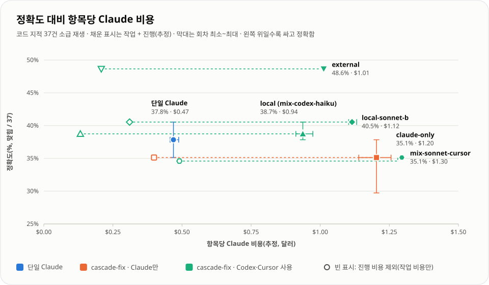

# 가성비 측정: cascade-fix vs 단일 Claude (2026-10-26)

cascade-fix를 쓰는 것이 Claude 하나로 직접 고치는 것(단일 Claude)보다 가성비가 좋은지 같은 표본으로 쟀다. 계획은 `docs/2026-10-26-cost-effectiveness-plan.md`, 지난 구성 비교는 `docs/2026-10-23-role-profiles-measurement-stage1.md`·`docs/2026-10-24-role-profiles-measurement-stage2.md`에 있다.

**결과: 정확도와 「아님」 오채택은 단일 Claude와 cascade-fix(`local`·`local-sonnet-b`)가 흔들림 안에서 같다(35~41%, 오채택 0~0.3건). Claude 비용은 무엇을 세느냐에 따라 뒤집힌다. 작업 에이전트만 세면 `local`이 단일 Claude의 28%로 가장 싸다. 그런데 메인 세션이 단계를 잇는 진행 비용(실제 사용 기록에서 추정, 지적당 약 $0.80)을 더하면 cascade-fix 구성은 모두 단일 Claude의 2.0~2.8배다. 항목당 처리 시간도 단일 Claude가 가장 짧다(1.2분, cascade-fix 2.0~3.2분). 지금 cascade-fix의 비용을 좌우하는 것은 작업자가 아니라 메인 세션 진행이다.**

<p align="center">
  <picture>
    <source media="(prefers-color-scheme: dark)" srcset="readme/cost-effectiveness-dark.svg">
    
  </picture>
</p>

## 측정 환경

- 코드: 이 브랜치(main `55e33e1` 기준, v1.5.1). 지난 결과(1·2단계)는 `34d162b`(v1.4.0)에서 쟀다. `git diff 34d162b..55e33e1`에서 코드 모드 작업자·판가름·의견 경로는 바뀌지 않아(프롬프트·합의·검증·작업 파일·`scripts/run-jobs.js` 그대로, Codex 러너는 구조만 정리, Cursor는 읽기 역할만 보강) 지난 결과를 다시 재지 않고 썼다. 판단 근거는 계획서 1절에 있다.
- 표본: 지난 측정과 같은 코드 모드 37건(사실 20 · 아님 16 · 재현 불가 1, sample-be 31 · synctx 6). `2026-10-19/sample.jsonl`을 복사해 썼다.
- 결과 폴더: `~/01.workspace/backup/cascade-fix-eval-runs/2026-10-26-cost/`(git 밖). 측정 프로필은 결과 폴더의 `profiles.toml`(`CASCADE_REPOS_TOML`)로 줬고, 이 기기의 `~/.claude/cascade-fix/repos.toml`은 읽지도 고치지도 않았다.
- 외부 전송 동의: sample-be·synctx 모두 OpenAI(Codex) 동의(2026-10-26). Cursor는 새로 돌리지 않았다.
- 로그인: `codex` ChatGPT 로그인(gpt-6.1-sol). 측정 중 만료되지 않았다.

| 구성 | code.a | code.b | 판가름 | 의견 | 회차 | 출처 |
| --- | --- | --- | --- | --- | ---: | --- |
| **단일 Claude**(기준선) | Opus 5.5 high 혼자 판정·수정·검증 | - | - | - | 3 | 이번 |
| `claude-only` | Sonnet 5.5 low | Haiku 5.5 low | Opus 5.5 high | Fable 5.1 high | 3 | 1·2단계 |
| `local`(= `m-mix-codex-haiku`) | Codex low | Haiku 5.5 low | Opus 5.5 high | Codex | 3 | 1·2단계 |
| `local-sonnet-b`(이 기기 설정) | Codex medium | Sonnet 5.5 medium | Opus 5.5 high | Codex | 3 | 이번 |
| `external` | Codex low | Cursor composer-2.5 | Opus 5.5 high | Fable 5.1 high | 1 | 1단계 |
| `mix-sonnet-cursor` | Sonnet 5.5 low | Cursor composer-2.5 | Opus 5.5 high | Fable 5.1 high | 1 | 1단계 |

cascade-fix 구성은 모두 채택 규칙을 끄고 돌린 뒤 켬 값을 반사실로 다시 계산했다(`eval/adopt_recalc.py`, 9회 모두 검증 통과). 내장 프로필 기본값이 켬이라 표의 대표값은 켬이다.

## 잰 방법

### 단일 Claude(`eval/solo.py`)

- 항목마다 표본 커밋에 분리 워크트리를 만들고(훅 끔, 저장소 `setup` 명령 실행) `claude -p --model claude-opus-5-5 --effort high --output-format json --json-schema <작업자 스키마>`를 띄웠다. 사용자 설정·플러그인·훅·MCP는 싣지 않았다(`--setting-sources project --strict-mcp-config`). 편집과 Bash는 자동 승인했다(`--permission-mode acceptEdits --allowedTools Bash`). 동시 1, 항목당 시간 제한 30분.
  - 사용자 `~/.claude/CLAUDE.md`는 이 설정으로도 실렸다(평소 직접 고칠 때와 같은 조건이라 그대로 뒀다).
- 프롬프트는 `prompts/worker-code.md`를 그대로 렌더하되 「두 작업자」 문장과 「현재 디렉터리는 사용자 저장소」 문장만 바꿨다. 그래서 「설계 결정 기준」 절이 cascade-fix 작업자와 글자까지 같다. 정답·다른 구성 결과는 주지 않았다.
- 출력은 작업자와 같은 스키마(`verdict`·`needs_design_decision`·`reason`·`verify`)다. 채점 판정: 사실·설계 결정 아님·패치 있음 → 사실, 사실·설계 결정 → 판정 없음(사람 목록), 아님 → 아님, 재현 불가 → 재현 불가, 못 정함 → 판정 없음.
- 끝나면 워크트리 변경을 cascade-fix와 같은 방식(`cascade.patches.extract`, format 포함)으로 뽑고, 작업자 검증과 같은 방식(`cli_steps.worker_verify`, 기준선에서도 실패하는 build·typecheck·lint 제외)으로 다시 검증했다. 「사실」로 판정한 패치가 검증에서 실패한 경우는 111건 중 0건이었다.

### cascade-fix(`local-sonnet-b` 새 측정)

1·2단계와 같은 절차다: `eval/replay.py --profile m-local-sonnet-b`(확인 실행 1건 뒤 본 실행) → 남은 Claude 작업을 스킬의 Workflow(`scripts/run-jobs.js` 원본과 같은지 대조함)로 → `CF usage` → `judge` → 판가름 Workflow → `adjudicate` → Codex 의견(`RR --opinion`) → `apply` → `report` → `--collect`. 재검토는 돌리지 않았다. 이 단계 진행을 돕는 보조 스크립트(`drive.py`, 결과 폴더)는 CF 명령을 항목마다 부르기만 하고 판정에는 손대지 않는다.

### 비용(두 층)

| 층 | cascade-fix | 단일 Claude |
| --- | --- | --- |
| 작업 비용 | 작업자·판가름·의견 에이전트(`claude-usage.json`, 켬 값은 round1-core에 끔 실행의 의견 비용을 더함) | 항목 세션 전체(`cascade.usage.read_session`) |
| 진행 비용 | 메인 세션이 명령을 잇고 Workflow를 띄우는 몫(**추정**, 항목당 $0.80) | 없음(세션 자체가 작업) |

- 두 층 모두 세션 기록 JSONL의 `message.usage`를 메시지 id마다 마지막 값으로 세고 같은 단가표로 값을 매겼다. 단일 Claude 111세션 모두 이렇게 센 값이 `claude -p`가 보고한 `total_cost_usd`와 같았다(차이 0).
- 진행 비용(`eval/orchestration_cost.py`): 이 기기에서 cascade-fix를 실제로 쓴 메인 세션에서, `init`을 부른 메시지부터 `report` 뒤 사람의 다음 입력 직전까지의 메인 세션 메시지만 셌다(하위 에이전트·`detect`·첫 검토 제외, 포크로 겹친 실행은 한 번만). 측정 세션은 37건을 묶어 돌려 실제 사용과 달라 쓰지 않았다.

| 세션 | 대상 | dry-run | 지적 | 진행 비용 | 요청 수 | 캐시 읽기 |
| --- | --- | --- | ---: | ---: | ---: | ---: |
| ff0d98ea | sample-infra | 아니오 | 7 | $4.42 | 27 | 1,870만 |
| 90d26c0e | sample-be #782 | 예 | 3 | $3.25 | 53 | 1,020만 |
| 90d26c0e | sample-be #782 | 아니오 | 4 | $2.20 | 26 | 850만 |
| 5fcf0206 | sample-infra | 아니오 | 5 | $4.68 | 39 | 1,930만 |
| 4b33636c | sample-infra | 아니오 | 1 | $1.24 | 25 | 430만 |
| 94d93e78 | synctx | 아니오 | 1 | $2.32 | 25 | 920만 |
| 3774eb74 | sample-docs | 예 | 3 | $1.21 | 19 | 320만 |

  - 맞춤: 고정 $1.04 + 지적당 $0.50. 평균 규모 3.4건에서 지적당 $0.80(대표값), 지적 1건 실행이면 $1.54. 모두 Opus 5.5 메인 세션이고, 비용의 대부분이 캐시 읽기(요청마다 쌓인 대화 맥락을 다시 읽음)다.

### 시간(`eval/run_time.py`)

항목당 처리 시간 합이다. Claude 에이전트는 기록의 첫~마지막 시각, Codex·Cursor 작업자는 원장의 `jobs`→`workers-*` 간격, 단일 Claude는 세션 시간(`duration_ms`)을 더한다. 동시 실행으로 겹친 시간도 각각 더하고, 하네스 검증·CLI 의견 시간은 뺀다. 지난 측정의 벽시계 시간은 기기 수면·의견 대기가 섞여 쓰지 않았다.

## 결과

### 한눈에

| 구성 | 회차 | 정확도(맞힘/37) | 「아님」 오채택 | 사람 목록 | 항목당 Claude 비용(작업 + 진행) | 단일 Claude 대비 | Codex · Cursor 입력 토큰(회당) | 항목당 처리 시간 |
| --- | ---: | ---: | ---: | ---: | ---: | ---: | ---: | ---: |
| 단일 Claude | 3 | 37.8% [35.1~40.5] | 0 | 21.3 [20~22] | $0.47 | 100% | - · - | 1.2분 [1.1~1.2] |
| claude-only | 3 | 35.1% [29.7~37.8] | 0.7 [0~1] | 22 [21~23] | $0.40 + $0.80 = $1.20 | 257% | - · - | 2.0분 [1.7~2.3] |
| local (mix-codex-haiku) | 3 | 38.7% [37.8~40.5] | 0 | 20.7 [20~21] | $0.13 + $0.80 = $0.94 | 200% | 675만 · - | 2.5분 [2.3~2.6](2회) |
| local-sonnet-b | 3 | 40.5% | 0.3 [0~1] | 20 | $0.31 + $0.80 = $1.12 | 238% | 934만 · - | 2.1분 [2.0~2.3] |
| external | 1 | 48.6% | 3 | 15 | $0.21 + $0.80 = $1.01 | 216% | 692만 · 144만 | 2.6분 |
| mix-sonnet-cursor | 1 | 35.1% | 3 | 19 | $0.49 + $0.80 = $1.30 | 276% | - · 145만 | 3.2분 |

값은 회차 평균 [최소~최대]다. `local`의 처리 시간은 3회차를 뺀 2회 평균이다(3회차는 2단계 중 기기 수면으로 replay가 멈춘 구간이 Codex 시간에 들어가 항목당 9.1분으로 튄다).

### 진행 비용 가정별(민감도)

| 구성 | 진행 비용 0 | 평균 규모(기본) | 지적 1건 실행 |
| --- | ---: | ---: | ---: |
| 단일 Claude | $0.47 (100%) | $0.47 (100%) | $0.47 (100%) |
| claude-only | $0.40 (85%) | $1.20 (257%) | $1.94 (414%) |
| local (mix-codex-haiku) | $0.13 (28%) | $0.94 (200%) | $1.68 (358%) |
| local-sonnet-b | $0.31 (66%) | $1.12 (238%) | $1.85 (396%) |
| external | $0.21 (44%) | $1.01 (216%) | $1.75 (374%) |
| mix-sonnet-cursor | $0.49 (105%) | $1.30 (276%) | $2.04 (434%) |

진행 비용을 지적당 약 $0.34 아래로 줄여야 `local`이 단일 Claude와 같아진다($0.13 + $0.34 = $0.47).

### 새로 잰 구성의 회차별

| 구성 · 회차 | 정확도 | 「아님」 오채택 | 사람 목록 | Opus 끔/켬 | Claude 비용 끔/켬 | Codex 입력 | 처리 시간 |
| --- | ---: | ---: | ---: | ---: | ---: | ---: | ---: |
| 단일 Claude 1 | 13 (35.1%) | 0 | 22 | 37 | $18.05 | - | 1.2분 |
| 단일 Claude 2 | 14 (37.8%) | 0 | 22 | 37 | $16.91 | - | 1.1분 |
| 단일 Claude 3 | 15 (40.5%) | 0 | 20 | 37 | $17.09 | - | 1.1분 |
| local-sonnet-b 1 | 15 (40.5%) | 0 | 20 | 18 / 8 | $16.34 / $11.03 | 921만 | 2.1분 |
| local-sonnet-b 2 | 15 (40.5%) | 0 | 20 | 18 / 8 | $16.67 / $11.31 | 961만 | 2.0분 |
| local-sonnet-b 3 | 15 (40.5%) | 1 | 20 | 21 / 9 | $18.46 / $12.10 | 919만 | 2.3분 |

- 단일 Claude 항목 비용은 $0.15~1.18(중앙값 $0.47), 세션 시간은 11초~4.6분(중앙값 59초)이었다(111세션). 하위 에이전트는 한 번도 쓰지 않았다. 오류·시간 초과는 111세션 중 0건이다.
- `local-sonnet-b`의 Sonnet B는 회당 약 $7.2로, `local`의 Haiku B(회당 약 $0.4)보다 크게 비싸다. A(Codex low→medium)와 B(Haiku low→Sonnet medium)를 올렸지만 정확도는 흔들림 안(38.7% → 40.5%)이다.
- `local-sonnet-b` Codex 의견은 회차마다 1·2·1건 돌았다. 대체 실행·배정 바뀜은 111작업 중 0건이다.

### 정답별(회차 평균)

| 정답 | 단일 Claude | claude-only | local | local-sonnet-b | external | mix-sonnet-cursor |
| --- | --- | --- | --- | --- | --- | --- |
| 사실(20) 맞힘/사람 | 13.3 / 6.0 | 12.7 / 7.0 | 14.0 / 5.0 | 14.3 / 5.0 | 17 / 3 | 13 / 6 |
| 아님(16) 맞힘/사람/오채택 | 0.7 / 15.3 / 0 | 0.3 / 15.0 / 0.7 | 0.3 / 15.7 / 0 | 0.7 / 15.0 / 0.3 | 1 / 12 / 3 | 0 / 13 / 3 |
| 재현 불가(1) 맞힘 | 0 | 0 | 0 | 0 | 0 | 0 |

정답이 「아님」인 16건은 거의 모두 사람 목록으로 간다(설계 결정 기준). 단일 Claude도 같은 기준을 받아 같은 모양이 나왔다.

### 흔들림

| 구성 | 3회 사이에 판정이 바뀐 항목 |
| --- | ---: |
| 단일 Claude | 18.9% (7건) |
| claude-only | 24.3% (9건) |
| local | 5.4% (2건) |
| local-sonnet-b | 8.1% (3건) |

### 구성끼리 갈린 항목(3회 다수결)

| 항목 | 정답 | 단일 Claude | claude-only | local | local-sonnet-b | external | mix-sonnet-cursor |
| --- | --- | --- | --- | --- | --- | --- | --- |
| rsbe-pr676-c0 | 아님 | 판정 없음 | 판정 없음 | 판정 없음 | 판정 없음 | **사실** | **사실** |
| rsbe-pr723-t6 | 아님 | 판정 없음 | 판정 없음 | 판정 없음 | 판정 없음 | 판정 없음 | **사실** |
| rsbe-pr723-w1 | 아님 | 판정 없음 | 판정 없음 | 판정 없음 | 판정 없음 | **사실** | 판정 없음 |
| rsbe-pr729-t3 | 아님 | 판정 없음 | 판정 없음 | 판정 없음 | 판정 없음 | **사실** | **사실** |
| rsbe-pr726-c0 | 아님 | 판정 없음 | 판정 없음 | 재현 불가 | 아님 | 아님 | 판정 없음 |
| rsbe-pr720-c1 | 사실 | 아님 | 판정 없음 | 아님 | 아님 | 사실 | 아님 |
| rsbe-pr723-t0 | 사실 | 판정 없음 | 사실 | 사실 | 사실 | 사실 | 사실 |
| rsbe-pr752-t0 | 사실 | 사실 | 판정 없음 | 사실 | 사실 | 사실 | 판정 없음 |
| rsbe-pr752-t1 | 사실 | 판정 없음 | 판정 없음 | 판정 없음 | 판정 없음 | 사실 | 판정 없음 |
| rsbe-pr758-t10 | 사실 | 판정 없음 | 판정 없음 | 판정 없음 | 판정 없음 | 사실 | 사실 |
| synctx-pr39-codex-1 | 사실 | 사실 | 판정 없음 | 판정 없음 | 판정 없음 | 사실 | 사실 |
| synctx-vux1-codex2-1 | 사실 | 사실 | 사실 | 사실 | 사실 | 판정 없음 | 판정 없음 |
| synctx-vux2-codex-1 | 사실 | 사실 | 사실 | 사실 | 사실 | 사실 | 판정 없음 |

굵은 「사실」이 「아님」 오채택이다(1회 구성은 그 1회). 나머지 24건은 여섯 구성이 같았다. 단일 Claude는 「아님」을 사실로 채택한 적이 없고, 판정이 cascade-fix 구성과 갈린 사실 항목(pr723-t0·pr752-t0·synctx-pr39)은 단일 Claude가 맞힌 것과 놓친 것이 섞여 있다.

## 비용

단가 기준: 2026-10-06 claude-api 스킬 자료(shared/prompt-caching.md, shared/model-migration.md) 기준, $/MTok. 캐시 읽기는 모델별 표기값(Haiku 5.5는 입력 단가의 0.1배), 캐시 쓰기는 5분 TTL 입력 단가의 1.25배·1시간 TTL 입력 단가의 2배. 구독 이용 한도가 이 추정 비용에 비례한다고 가정했다(「단일 Claude 대비」 비율이 그대로 이용 한도 비율이다).

이번 측정에 실제로 쓴 Claude 비용은 약 $130이다(실행 전 추정 $150~270).

- 단일 Claude 3회 $52.05 + 확인 실행 $0.45
- `local-sonnet-b` 3회 Workflow(끔) $51.47 + 확인 실행 약 $0.24
- 이 측정 세션(Opus, 진행·분석) 약 $26(문서 작성 전까지)
- Codex: 작업자 111작업(입력 약 2,800만 토큰) + 의견 4건(토큰 기록 없음)

## 측정 중 생긴 일

- **설정 파일 상대 경로.** 보조 스크립트가 첫 `judge` 때 측정용 repos.toml을 상대 경로로 넘겨 37건 모두 「검증 명령 없음」으로 멈췄다. 모델을 부르기 전 단계라 비용·결과에는 영향이 없고, 절대 경로로 고쳐 다시 돌렸다.
- **Codex 의견 순서.** `local-sonnet-b` 2회차 의견 2건은 3회차 replay(같은 Codex 로그인)가 끝난 뒤 돌렸다. 로그인이 겹치면 풀릴 수 있기 때문이다(1단계와 같은 처리).
- **이름표 겹침.** 표본에 같은 지적 id(`P1-1`·`P2-1`)가 두 항목씩 있어 Workflow를 이름표가 겹치지 않게 나눠 돌렸다. `CF usage`의 「일치하지 않음」 경고는 같은 Workflow 안의 다른 항목 에이전트라서 난 것이고 집계에 영향이 없다.
- **판가름이 외부 자원을 씀.** 3회차 `pr720-c1` 판가름이 로컬 mariadb 컨테이너로 50만 건 IN 절을 재현했고(정리했다고 보고), `pr726-c0` 판가름은 로컬 rule_engine 저장소와 golang 컨테이너(`--network none`)로 구 엔진을 확인했다. 1·2단계와 같은 성격이다.
- **판가름 커밋에 `.venv` 링크가 섞임.** synctx 판가름 몇 건이 미리 스테이징된 `.venv` 심볼릭 링크까지 커밋했다고 보고했다. 패치는 setup 경로를 빼고 뽑으므로 결과에는 영향이 없다.
- 오류로 끝난 항목, 다시 돌린 항목, 남은 워크트리는 없다. sample-be·synctx의 작업 트리와 워크트리 목록은 측정 전과 같다.

## 한계

- 표본 37건, 코드 모드만, 저장소 두 개(sample-be 31 · synctx 6). 1~3건 차이는 흔들림 안에 있다.
- 소급 dry-run이다. 회귀(적용 뒤 전체 테스트·사람의 되돌림)와 재검토는 재지 않았다. 모든 구성이 표본 커밋 뒤 정보(같은 저장소의 뒤 커밋, 다른 저장소 현재 상태)를 쓸 수 있었다.
- 패치 내용이 정답 패치와 같은지는 어느 구성도 자동 채점하지 않는다(판정만 채점).
- **진행 비용은 추정이다.** 실제 사용 7회에서 맞춘 값이고, 메인 세션에 쌓인 대화 길이에 크게 좌우된다. 단일 Claude는 빈 맥락의 헤드리스 세션이라, 사용자가 긴 대화 중인 메인 세션에서 직접 고치면 단일 Claude 쪽도 비싸진다. 이 비교는 그 차이를 반영하지 않으므로 cascade-fix에 불리한 쪽으로 기울 수 있다. 민감도 표를 함께 본다.
- cascade-fix의 재검토 단계 비용, 메인 세션의 자동 모드 분류기 호출 비용은 세지 않았다.
- 지난 결과(10-22~24)와 이번(10-26)은 날짜가 다르다. 코드 경로는 같지만 모델 서버 쪽 변화는 통제하지 못한다. `external`·`mix-sonnet-cursor`는 1회라 흔들림을 모른다.
- 비용 단가 기준일 2026-10-06. 구독 이용 한도가 비용에 비례한다는 가정.

## 해석

- **정확도**: cascade-fix를 써도 단일 Claude보다 정확해지지 않았다. 「아님」 오채택도 단일 Claude가 0건이다. 설계 결정 기준을 같은 문구로 주자 Opus 혼자서도 「아님」 항목을 사람에게 넘겼다. cascade-fix의 정확도 이점으로 보였던 것(Cursor 구성의 오채택을 거르는 일)은 구성끼리의 차이였다.
- **비용**: cascade-fix의 작업 비용 절감(특히 `local`, 단일 Claude의 28%)은 진짜다. 하지만 지금 방식은 메인 세션이 CF 명령·Workflow·결과 파일을 단계마다 오가며 실행당 요청 19~53회를 쓰고, 그때마다 긴 맥락을 다시 읽는다. 이 몫이 지적당 약 $0.80으로 작업 비용보다 크다. 그래서 Claude 이용 한도를 아끼는 것이 목표라면, 지금은 Opus 하나로 직접 고치는 편이 더 싸고 빠르다.
- **시간**: cascade-fix는 작업자 둘·검증·판가름을 차례로 거쳐 항목당 처리 시간이 길다(Codex가 든 구성은 Codex 시간이 절반 이상).
- **cascade-fix가 단일 Claude보다 나은 점**(이번에 재지 않은 것): 패치 두 개를 비교해 고르는 일, 하네스가 검증을 다시 돌려 채택하는 일, 보안 경로 차단, 사람 목록 분류와 보고서, 재검토 회차.

## 다시 만들기

```bash
C=~/01.workspace/backup/cascade-fix-eval-runs/2026-10-26-cost
# 단일 Claude(회차마다)
python3 eval/solo.py run --sample $C/sample.jsonl --out $C/solo-r1 --repos-toml $C/repos.toml --parallel 1
python3 eval/solo.py score --runs $C/solo-r1 --sample $C/sample.jsonl --json $C/solo-r1/score.json
# 진행 비용 추정(실제 사용 세션 기록)
python3 eval/orchestration_cost.py --session <세션.jsonl> … --json $C/analysis/orchestration.json
# 처리 시간
python3 eval/run_time.py --solo $C/solo-r1 --json $C/analysis/time-solo-r1.json
python3 eval/run_time.py --cascade $C/m-local-sonnet-b-r1/adopt-recalc --json $C/analysis/time-lsb-r1.json
# 표·차트
python3 eval/compare.py --spec $C/compare-spec.json --md $C/analysis/summary.md \
  --svg-light docs/readme/cost-effectiveness-light.svg --svg-dark docs/readme/cost-effectiveness-dark.svg
```

`compare-spec.json`은 구성마다 회차별 점수 파일(켬 값), 의견 비용을 더할 `score-all.json` 칸, 처리 시간(분)을 적고 진행 비용 가정을 둔다.

## 다음

- 진행 비용 줄이기가 가장 큰 과제다. 예: 메인 세션 대신 스크립트가 단계를 잇게 하기(judge→판가름→apply를 한 명령으로), 메인 세션을 가벼운 모델로, 결과 출력을 더 짧게. 지적당 약 $0.34 아래로 내려야 `local`이 단일 Claude와 같아진다.
- 진행 비용을 실제 사용에서 더 모아(지금 7회) 추정을 다듬는다.
- 이 결과로 추천 표(`cascade/recommendations.toml`)를 바꿀지는 정하지 않았다(사용자 결정).
